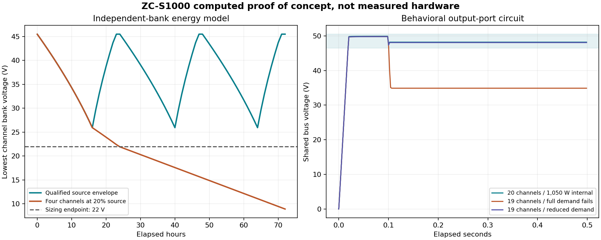

# IX-ZeroCell

[](https://github.com/BryceWDesign/IX-ZeroCell/actions/workflows/verify.yml)

**Battery-free DC power from real external energy, with a twenty-channel 1,000 W solar/supercapacitor design target.**

Bryce Lovell · Apache-2.0 · **Version 0.2.0**, expanded before publication.

**Current status: engineering design plus executed computational/behavioral proof of concept. No physical 1,000 W ZeroCell has been built or measured in this work. The stack is not fabrication-ready: its independent protection assemblies, fault coordination and installation design have open release gates.** The software badge reports only hosted software/build results. This update has not been pushed.

## What the upgrade contains

The new **ZC-S1000 revision B** integrates twenty source/storage channels into one nominal 48 V output, targeting **1,000 W useful DC at the load terminals**. It replaces the earlier unspecified custom output stage with modified populated ADI DC1924A boards and passive ballast/diode sharing. It retains solar as the abundant external source. RF/static harvesting remains a separately testable source option with **zero assumed contribution** to this baseline.

| Design quantity | Current revision B |
|---|---:|
| Channels | 20 |
| Useful output target | 1,000 W DC, 46.5–50.5 V |
| Reserved common losses/controls | 50 W |
| Conservative storage stress budget | 60 W per channel, not a measured channel rating |
| No-input service target | 16 hours, starting with every bank ready |
| PV | 60 × 420 W panels, 25.2 kWp nameplate |
| Storage | 60 Eaton modules/channel, 1,200 total |
| Calculated usable storage | 35.109 kWh |
| Bounded 16-hour demand | 33.244 kWh |
| Required source window | 400 W actual PV/channel for 8 hours; at least 340 W conditioned/channel |
| Capacitor mass alone | 17,640 kg, excluding racks |
| Full-power single-channel redundancy | No; reduce useful load to 950 W after one channel loss |

These quantities supersede the earlier 56-module/55 W stack concept. Daily replenishment and storage margins depend on measured component limits and actual source availability. There is no guarantee through arbitrary darkness, no 120 V AC output and no claim of a compact portable kilowatt generator.

## Engineering package

- [Authoritative stack design and calculations](docs/stack1000/DESIGN.md).
- [Assembly-scope BOM](hardware/stack1000/BOM.md), [CSV](hardware/stack1000/BOM.csv) and [JSON](hardware/stack1000/BOM.json): selected power parts, modifications, protection, wiring, racks and test equipment. **Unreleased assemblies are explicitly marked; this is not a closed fabrication BOM.**
- [Power connection schedule](hardware/stack1000/WIRING.csv) and [scope/terminal notes](hardware/stack1000/WIRING.md). Control/protection interface labels are not invented physical pinouts.
- [53-step assembly and commissioning walkthrough](docs/stack1000/ASSEMBLY.md), progressing from bounded one-channel tests to a reviewed full installation.
- [Open construction-release gates](docs/stack1000/RELEASE_GATES.md), with a [machine-readable register](hardware/stack1000/release_gates.json).
- [Executed proof of concept](docs/stack1000/PROOF_OF_CONCEPT.md), [actual experiment protocol](docs/stack1000/BENCH_PROTOCOL.md), [external-energy/RF/static qualification](docs/stack1000/EXTERNAL_ENERGY.md) and [primary component sources](docs/stack1000/SOURCES.md).

The prior 50 W PDF and concept-A note are included for traceability under `docs/stack1000/`; revision B governs current construction settings. The existing **ZC-D10** small reference build remains under [docs/build](docs/build/ASSEMBLY_GUIDE.md), with its [printable module assembly/BOM guide](docs/build/ASSEMBLY_AND_BOM.pdf). Its 5 V/10 W target, small 2.5 F bank and short backup interval must not be confused with the stack.

## What actually ran

| Check | Local result |
|---|---|
| Python tests | 76 passed |
| Small-bank native C++ fault/energy cases | 23 passed |
| Twenty-channel native advisory cases | 15 passed |
| Retained ATmega328P monitor compile | Passed: 9,152 flash bytes; 464 static SRAM bytes |
| Stack independent-bank energy cases | Five executed, including inadequate-source/empty-bank controls |
| Stack output-port SPICE cases | Five executed, including overload and lost-channel failures |
| Retained small-reference circuit cases | Five power-path cases and one voltage-window case executed |
| Physical 1,000 W output and fault qualification | Not performed |
| Hosted CI for this update | Unknown until uploaded and run |

See [current release receipt](results/release_verification.json), [software receipt](results/verification.json), [stack campaign](results/stack1000/campaign.json) and [circuit summaries](results/stack1000/spice/summary.json). Raw logs and labeled traces are included.



The normal calculation restores all twenty banks over three specified daily cycles. Four heavily shaded channels, prolonged darkness, empty source-free storage and inadequate capacitance correctly produce unmet load. The output model supplies its nominal internal demand, but nineteen low-current-limit channels fail full demand and pass the reduced-load case. The SPICE converter ports are behavioral, not vendor switching/thermal models. Independent-bank energy calculations and output-port screens do not establish stability or protection of an assembled device.

## Reproduce and inspect

Python 3.11+, a native C++ compiler and ngspice are required for the corresponding checks. The core Python implementation has no third-party runtime dependency.

```sh
python scripts/check_manifest.py
python scripts/verify.py
python -m ix_zerocell stack
python scripts/run_reference_poc.py
python scripts/run_stack_spice.py
python scripts/build_avr.py --fetch
```

The last command supports Linux x86_64 with pinned official Arduino tools. The coordinated Linux command is `python scripts/verify_release.py --avr-fetch`. No command flashes a device or actuates power hardware. See [installation notes](INSTALL.md) for Windows limitations and [GitHub update instructions](docs/GITHUB_UPDATE.md) for applying the full tree without the obsolete patch.

`firmware/stack_supervisor.h` implements advisory fault/load policy only. There are no hidden acquisition drivers or claimed actuator outputs. The measurement reviewer consumes actual supplied twenty-bank data, checks uncertainty and energy closure, and never promotes a synthetic trace or operator label into hardware certification.

## What remains before a working-device claim

Complete the independent protection/driver assembly, verify modified-board operation and efficiency across the actual input/temperature range, coordinate capacitor fault energy and interrupt ratings, finish installation engineering, and perform the metered one-channel/five-channel/twenty-channel tests. [G01–G07](docs/stack1000/RELEASE_GATES.md) identify those deliverables explicitly. The full bank should not be purchased or energized solely on this repository's computed results.

The original unsubstantiated 1,120–1,370 W RF/static claims remain withdrawn under [archive](archive/README.md). Real RF and electrostatic harvesting are possible, but their actual external input must support the proposed load. The solar design does not retroactively prove that original mechanism. [Claim authority](docs/CLAIMS.md) states exactly what this release does and does not establish.
