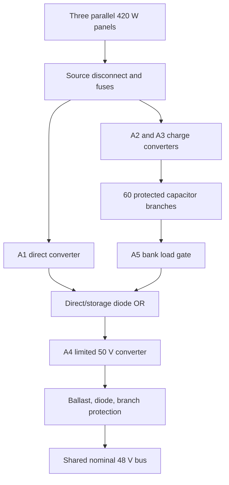

# ZC-S1000, twenty-channel 1,000 W DC design

Version **0.2.0**. Revision B of the engineering design, not a new software version. This document supersedes `PRIOR_CONCEPT_A.md` and the prior 50 W PDF wherever values conflict. Those two documents are retained for traceability, not as alternative assembly instructions.

**Status: source-backed engineering design and executed numerical/behavioral proof of concept. The 1 kW assembly has not been built or measured. Construction release remains blocked by the explicit items in `RELEASE_GATES.md`.** The small ZC-D10 reference assembly remains a separate, more complete module-level build. Neither program establishes a measured hardware rating.

## Purpose and energy boundary

Deliver 1,000 W of useful DC power at a nominal 48 V output, accepted steady range 46.5–50.5 V. This is about 20.83 A at 48 V, or 21.51 A at the low acceptance voltage. It is not a 120 V AC outlet or grid-tie product. Twenty independent source/storage channels feed a single protected output. Sunlight is the selected, sufficiently abundant external energy source. No conventional battery is included.

The intended operating cycle is sixteen hours without sunlight followed by eight hours of qualified input. At the beginning of a full no-sun interval, every storage module must be at least 45.5 V and satisfy measured capacitance/leakage acceptance. A twenty-first channel would be required for a separately designed full-power N+1 configuration. For twenty channels, loss of one reduces the conservative useful-load target to 950 W; a common-bus fault shuts down all channels.

The original ordinary-ambient RF/static kilowatt claim remains unsupported. See `EXTERNAL_ENERGY.md` for real harvest budgets and source-admission criteria. There is no internally recirculated energy credit.

## Revision B resolves and changes

- Replace the conceptual custom A4 output converter with a populated **ADI DC1924A** board per channel, modified for a nominal 50.0 V output and approximately 1.17 A current limit. ADI explicitly allows reduced-load operation below its nominal 36 V input range. Performance at the project's 21–51 V operating input still requires testing; the datasheet does not guarantee our complete modified assembly.
- Implement sharing using a physical **1.2 ohm, 1%, 50 W** ballast resistor per output, reverse-blocking diode and matched feeder paths. This removes the unimplemented active-droop PCB from the earlier concept. Ballast losses are counted in the 85% useful-output-path efficiency floor.
- Increase from 56 to **60 Eaton modules per channel**, hence 1,200 total. Use a **60 W per-channel storage stress budget**, not a claim that every channel can deliver exactly 60 W at every voltage.
- Require **400 W actual PV electrical input per channel** during the specified eight-hour interval, providing at least **340 W conditioned power** after source-path losses and daylight auxiliaries. These are operating conditions, not predictions from nameplate wattage.

## Channel topology

Replicate this topology twenty times. Keep the twenty positive capacitor buses separate. All converters are nonisolated, with a planned common return and protective enclosure bonding; this is **not galvanic isolation**. Do not connect the banks directly together. Signal acquisition must tolerate route voltage drops and common-mode disturbances. Use differential/isolated instrumentation where needed.

Split distribution into four sections of five channels, with section isolation and a main output disconnect. Each section and the common bus need DC fault interruption coordinated to all contributing sources. Reverse blocking stops healthy branches feeding a failed converter in normal reverse conditions; it does not replace forward fault protection or guaranteed isolation after a shorted diode. Protect each feeder at its source and at the bus end against backfeed.

## Converter settings and connections

The controlling reference is ADI DC1924A manual/schematic `dc1924afa.pdf`, checked 26 October 2026. Confirm board revision before rework. TP1 = VIN; TP3 = input power ground; TP2 = VOUT; TP4 = output power ground; TP5 = /SHDN. Use the power terminals for power, not small signal turrets. All four boards use JP1's position marked DCM. Do not use forced continuous mode, which can allow reverse operation.

| Setting | A1 direct | A2/A3 charge, each | A4 output |
|---|---:|---:|---:|
| Output calibration | 49.5 V | 46.5 V | 50.0 V |
| R49 output-current setting | 86.6 kohm | 34.8 kohm | 143 kohm + 10 kohm sealed trim, calibrated to 1.17 A |
| R13 output divider top | 392 kohm + 20 kohm trim | 374 kohm + 5 kohm trim | 392 kohm + 20 kohm trim |
| R16 divider bottom | 10.0 kohm, 0.1% | same | same |
| R53/R54 input regulation | 590 kohm / 20 kohm | 649 kohm / 20 kohm | unpopulated, retain default R55 link |
| R55 | remove | remove | retain |
| R11/R14 input UVLO | 590 kohm / 20 kohm | same | 294 kohm / 20 kohm |
| Nominal current limit | 1.99 A | 4.96 A | 1.17 A after calibration |

Resistors are rework values, not automatically verified assembled voltages. Use 0.1% fixed divider/current-setting parts, retaining the board's 0.007 ohm R57 output shunt. The nominal current formula is `1.208/(0.001 × R57 × R49)`. The A4 current-setting range spans approximately 1.13–1.21 A. Require measured 1.14–1.20 A over the qualified operating envelope. A4 input UVLO is approximately 19.37 V rising and 18.59 V falling; this sits below the bank gate cutoff.

A1's lower input-regulation setpoint gives load service priority over the two chargers when PV weakens. This is fixed input-voltage regulation, not true MPPT. Verify charge current from a nearly empty bank; no successful cold-charge test is presumed.

A4's original output MOSFETs are 60 V parts. Do not assume a 100 V diode protects them from overshoot. Normal 50 V output needs a measured transient margin below every board component's rating. That is a release gate. The 22 uH/200 kHz power stage at 22 V input and 50 V output has an approximate boost ripple of 2.8 A peak-to-peak; this is only a first-order screen, not switching/SOA validation.

## Passive sharing

Wire A4 TP2 through a 1.2 ohm ballast resistor, then a STPS10H100CFP blocking diode (both anodes joined, common cathode downstream), then the protected feeder to the section bus. Place the ballast before the diode; the diode's cathode faces the shared bus. Fit the dedicated output fuse and bus-end backfeed fuse. Connect A4 TP4 to the assigned output return star. The diode requires a heat sink selected from measured dissipation.

For analysis, characterize each complete channel around 0.8–1.14 A as an equivalent source `E - R×I`, with E in 49.4–49.6 V and R in 1.23–1.27 ohm including ballast, diode incremental slope and feeder. This is a **measured acceptance envelope**, not a guaranteed component tolerance. Fixed 1% ballast tolerance alone does not establish it. Sweep all relevant input voltages and temperatures; change the design if channels cannot stay inside these limits. Never compensate ballast drop with remote sensing at the shared bus.

At 1.2 A, the ballast dissipates 1.728 W. The 50 W nameplate assumes its specified mounting/heat sink and does not establish fault-pulse survival. Twenty independently current-limited outputs can supply at most approximately 24 A in steady healthy operation; local capacitors and abnormal faults can supply much higher transient currents. Do not derive fuse interrupt capacity solely from the 24 A limit.

The steady-state model finds an approximately 48.1 V bus at the 1,050 W internal target. The extra 50 W is reserved for common controls and distribution, yielding 1,000 W at the external terminals. Limit the main distribution loop resistance to 0.02 ohm or less; verify actual voltage drop at the load. No unconditional motor-start or surge-load rating is assigned.

## Storage and source sizing

Each channel has 60 parallel module branches. Each branch has a local 2 A DC fuse followed by a 2.2 ohm/200 W/5% resistor before the channel bus. Effective sizing capacitance is 60 × 166 F × 0.8 = **7,968 F**. Use the 45.5–22 V internal module window; gate the load before violating the accepted module endpoint.

`E = 0.5 × 7968 × (45.5² - 22²) / 3600 = 1755.45 Wh/channel`

`P_bound = 60/0.85 + 4 + 60×0.01×47.5 + 0.8 = 103.888 W/channel`

Sixteen-hour demand is **1,662.21 Wh/channel**, leaving **93.24 Wh**, approximately **5.61%** of demand. Total usable storage is **35.109 kWh**; total bounded night demand is **33.244 kWh**. This conservative budget stresses all channels at 60 W, beyond their normal approximately 52.5 W delivery.

Twenty-four-hour bounded demand is **49.866 kWh**. Conditioned input is 20 × 340 W × 8 h = **54.4 kWh**. Applying 95% charge efficiency pessimistically to all of it leaves **51.68 kWh**. Input screening uses 400 W × 90% minus 10 W daylight auxiliaries = 350 W, exceeding the 340 W requirement. This small replenishment margin does not cover arbitrary cloud or seasonal losses. The model also enforces the 9 A charging limit, rather than relying only on daily energy arithmetic.

Module leakage must be at most 10 mA after conditioning throughout the qualified range. Eaton's nominal 5.2 mA listing is not a guaranteed 10 mA ceiling across temperature. Capacitance must be at least 132.8 F per module; ESR at most 10 milliohm. Test and reject or resize failing modules. Use channel-ready status only when all branch voltages satisfy the initial condition, not just one common-bus reading.

## Fault and control requirements

Retain the prior independent charge-OV, thermal, alarm and bank-gate protection architecture. The fully detailed control-board interconnect and protection coordination are **not released**, as identified in `RELEASE_GATES.md`. A logging program cannot replace these circuits. No energized full-bank assembly is authorized by these design notes alone.

Charge OV target: 47.0 V, accepted trip 46.7–47.3 V, independent of software, latched and manual-reset. Open K1 and inhibit A1–A4 on global channel fault; open the A5 bank path as applicable. Nominal bank load gate: about 21 V cutoff, 32 V restart. Verify actual internal module minimum stays above 22 V during the rated energy test; the lower electrical cutoff only provides shutdown margin. NC body-temperature interlocks target 45 °C, while energy/efficiency qualification remains 10–35 °C. Module alarm and switch-harness continuity must be supervised; an open-collector alarm alone does not prove an intact cable.

An unrestrained common bank fault would be severe. At 48 V and resistor minimum 2.09 ohm, the branch bound is about 22.97 A, or **1,378 A per 60-module bank**, before PV and local capacitor contributions. Fuse clearing and resistor pulse survival are unresolved until coordinated from component data and bounded testing. A module-terminal fault upstream of its fuse is not covered by that branch resistor bound.

`firmware/stack_supervisor.h` is a tested advisory implementation for twenty samples. It latches unhealthy channels and calculates reduced load service. It has no GPIO, acquisition driver or contactor actuation. The old Uno firmware monitors only its own small-bank profile and is not the 1 kW controller. Loss of software, telemetry or communication must leave hardware protection effective.

## Mechanical scale

60 panels give 25.2 kWp nameplate and about 116.05 m² of panel surface before access/tilt spacing. 1,200 capacitor modules at 14.7 kg each weigh **17,640 kg**, before frames and electronics. Allocate four racks per channel, fifteen modules each: eighty racks total, each with at least 300 kg structural working capacity subject to mounting/anchorage review. The earlier 2×2×6 ft cabinet allowance is not a fabrication drawing. Floor loading, seismic/wind anchorage, access, cooling and PV installation are site-specific engineering work.

This intentionally preserves the previous architecture. It is not claimed to be an economical or minimum-size 1 kW installation. Battery-free overnight operation using this commercial EDLC choice is expensive and physically large; prices have not been fabricated or quoted.
